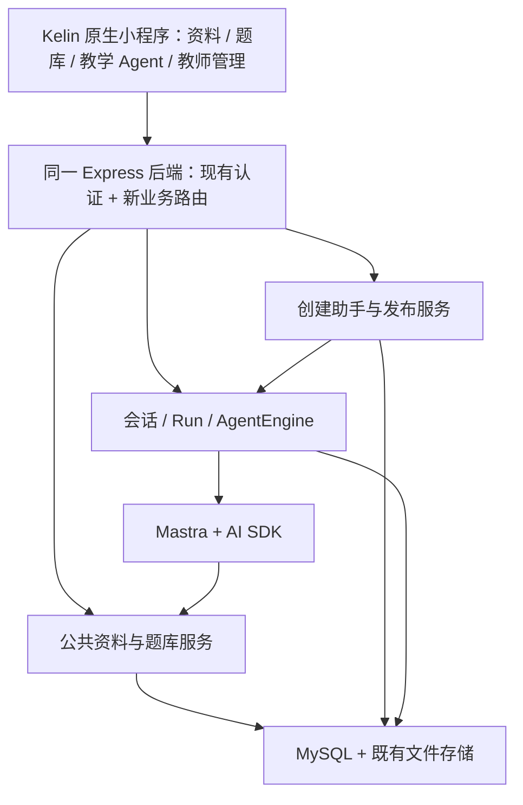

# 第二期：Agent 后端与 API

## 现状与目标

Kelin 当前是 Express CommonJS 后端、MySQL、服务器文件存储和原生小程序。参考 Agent 服务是 TypeScript ESM，已有 Mastra + AI SDK 与 AgentEngine 执行接口。

实现约定：保留 AgentEngine 边界，把 Agent 能力移入 Kelin 后端模块。继续使用已接入的 Mastra + AI SDK，不另建一套 Agent 编排框架。该技术选型来自代码评估；产品要求是单后端，框架可以在接口兼容、验收通过的条件下替换。

本文件在[题库验收](../phase-1-question-bank/03-delivery-and-acceptance.md)通过后执行。图中的题库服务由第一期提供，本期连接工具与教学业务；具体顺序见[Agent 实施与验收](06-delivery-and-acceptance.md)。

## 合并约束

- 遵守[共用身份、API 与迁移约定](../01-shared-foundation.md)，移除参考服务的 `x-demo-user` 身份路径。
- 参考服务中的 UUID 用户不能直接作为既有 MySQL 用户 ID 使用。
- 学生作业需要新的私有附件业务入口；原教师公共上传接口不直接开放给学生。
- 现有 API 和新增模块由同一服务入口启动，不要求教师/学生连接第二个后端地址。
- 原参考服务中的整库 JSON 状态存储、D1/R2 部署适配不直接搬入 Kelin。

## 运行环境核实

Kelin README 记录生产 Node.js 22；参考 Agent 工程声明 Node.js >=26。这是两份工程的基线差异，不等于已证明 Mastra 本身要求 Node.js 26。

实现前必须验证锁定依赖在拟采用 Node.js 版本上的构建与运行，确定 CommonJS/ESM 模块边界。优先将新增 TypeScript 模块编译并挂载到既有服务，不顺带重写所有旧路由。最终版本、构建入口、启动方式写入部署文档后再交付；本规格不执行运行环境升级。

## 数据实体与关系

以下是逻辑实体，具体表名可调整，但关系与隔离规则不能省略。

| 实体 | 核心关系与约束 |
| --- | --- |
| `Agent` | 教师所有者、名称、简介、当前草稿、当前发布版本 |
| `SkillRevision` | 不可变生成内容、内容哈希、创建助手来源记录、资源清单 |
| `AgentVersion` | Agent + SkillRevision + 模型配置快照 + 版本号；发布/试聊快照不可变 |
| `ModelProfile` | 管理员配置的模型目录；指向受保护的模型连接，不向客户端返回密钥 |
| `Conversation` | 所有者、执行的 AgentVersion、模式；创建助手会话另关联目标教学 Agent |
| `Message` | Conversation 内序号、角色、正文、附件与显式题目引用 |
| `Run` | 触发消息边界、AgentVersion、模型快照、状态、取消状态、实际使用配置 |
| `RunEvent` | `(run_id, sequence)` 唯一；可重放文本、工具、引用和终态 |
| `ToolInvocation` | Run、工具与版本、参数摘要、结果来源、状态 |
| `LibraryResource` / `LibraryRevision` | 复用第一期资源契约，本期纳入普通教学文件与定位片段 |
| `Citation` | 回答消息、Run、资料 ID、实际修订、页码/题号/片段及可展示来源 |
| `ConversationAsset` | 私有会话附件、所有者、解析状态、文件资源引用 |
| `UsageRecord` | Run/模型步骤/外部计费操作、使用人、用途、计量信息、价格快照与费用状态 |
| `UserCapability` | 对现有账号增量授予平台管理能力，不改变现有 teacher/student 判断 |

资源身份与修订规则由[共用约定](../01-shared-foundation.md)维护。

关键唯一约束：

- 同一客户端消息请求 ID 在所属用户/会话内只能产生一次消息和 Run。
- 同一会话最多一个活动 Run；并发请求不能把消息混入另一轮上下文。
- 费用按计费操作幂等入账，事件重放和回调重试不能重复累计。

## 拟定 API

路由名称是实现约定。鉴权和响应语义为契约；所有列表必须分页。

| 路由 | 用途 |
| --- | --- |
| `GET /api/ai/agents` | 已发布 Agent 列表 |
| `GET /api/ai/agents/:id` | 学生可见说明与当前发布信息 |
| `GET /api/ai/models` | 教师可选择的模型；不含连接密钥 |
| `POST /api/ai/agents` | 教师建立草稿 |
| `POST /api/ai/agents/:id/builder-sessions` | 创建或修改 Skill 的助手会话 |
| `POST /api/ai/agents/:id/test-conversations` | 固定草稿快照的教师试聊 |
| `POST /api/ai/agents/:id/publish` | 发布不可变版本 |
| `POST /api/ai/conversations` | 按当前发布版本创建学生会话 |
| `GET /api/ai/conversations` | 当前用户历史会话 |
| `POST /api/ai/conversations/:id/messages` | 提交消息；持久化后及时返回 messageId/runId |
| `POST /api/ai/conversations/:id/assets` | 上传归属于该会话的附件 |
| `GET /api/ai/runs/:id/events?afterSequence=...` | 鉴权后增量读取或流式订阅运行事件 |
| `POST /api/ai/runs/:id/cancel` | 取消当前用户的 Run |
| `GET /api/ai/teacher/agents/:id/usage` | 教师自己的 Agent 使用明细与费用 |
| `GET /api/ai/teacher/agents/:id/conversations` | 教师自己的 Agent 的学生会话列表 |
| `GET /api/ai/teacher/agents/:id/conversations/:conversationId` | 经所属关系校验的完整会话 |
| `/api/ai/admin/models`、`/api/ai/admin/prices` | 指定管理员维护模型和价格 |
| `GET /api/ai/admin/usage` | 平台费用监控 |
| `/api/library/...` | 公共资料详情、解析状态、版本引用；文件上传复用既有能力 |
| `/api/question-bank/...` | 复用第一期已交付接口，定义见[题库数据与 API](../phase-1-question-bank/01-data-and-api.md) |

附件下载同样执行所属会话/教师归属校验，不能仅凭文件 ID 访问。流式接口单独定义事件编码；具体传输见[运行规格](01-authoring-and-runtime.md)。
